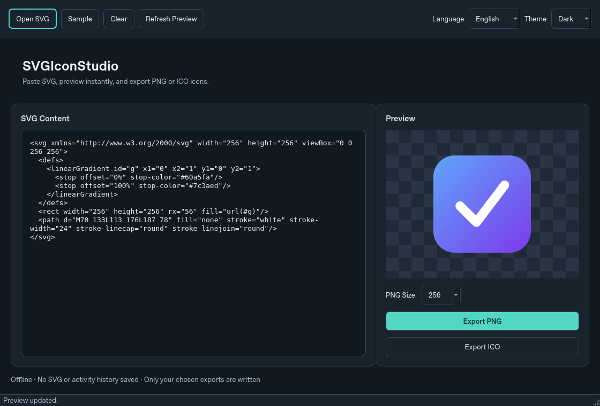
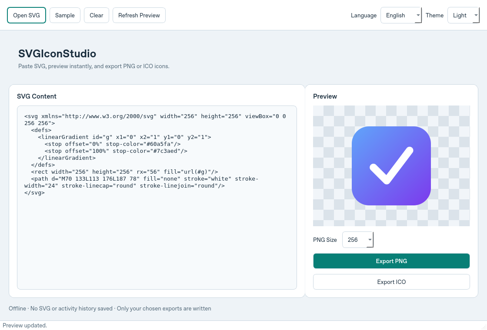

# SVGIconStudio

離線 SVG 圖示工具：貼上或開啟 SVG，即時預覽並輸出 PNG／ICO。支援繁體中文、英文與深淺色介面。

An offline desktop tool for previewing SVG icons and exporting PNG or ICO files, with Traditional Chinese / English and light / dark themes.

## 介面 / Screenshots

以下為程式實際執行畫面，僅使用內建 SVG 範例，介面語言為英文。

Actual application screenshots using only the built-in SVG sample, shown in English.

### 深色 / Dark



### 淺色 / Light



## 使用 / Usage

1. 貼上 SVG，或按 `Ctrl+O` 開啟 UTF-8 SVG 檔案。
2. 預覽會自動更新；輸入錯誤會顯示在視窗內。
3. 選擇 PNG 尺寸後輸出，或直接輸出多尺寸 ICO。
4. 工具列可切換語言與主題；選擇僅在本次執行有效。

Paste SVG or open a UTF-8 SVG file with `Ctrl+O`. Preview updates automatically, with inline validation errors. Choose a PNG size or export a multi-size ICO. Language and theme choices apply to the current session only.

## 安裝與啟動 / Install and run

需要 Python 3.11+，以及可執行 Qt 的 Windows、macOS 或 Linux 桌面環境。

Requires Python 3.11+ and a Windows, macOS or Linux desktop capable of running Qt.

Windows PowerShell:

```powershell
python -m venv .venv
.\.venv\Scripts\Activate.ps1
python -m pip install -r requirements.txt
python main.py
```

macOS / Linux:

```bash
python3 -m venv .venv
source .venv/bin/activate
python -m pip install -r requirements.txt
python main.py
```

## 隱私與安全 / Privacy and safety

- 應用程式沒有遙測、網路請求或自動更新，不保存 SVG、來源路徑、使用紀錄或偏好設定。只寫入你明確選擇輸出的 PNG／ICO；作業系統檔案對話框、快取與當機處理不在此保證範圍內。
- SVG 上限為 256 KiB、2,000 個 XML 節點。支援路徑、形狀、基本行內樣式及本地漸層引用；拒絕外部資源、內嵌圖片、文字、濾鏡、樣式區塊、腳本、DTD 與 XML 實體。
- 轉圖使用獨立子程序，逾時上限 4 秒，輸出最長邊 1,024 像素；Linux 額外限制記憶體與 CPU。這些限制不等同完整作業系統沙箱。

The application makes no telemetry, network or update requests and does not persist SVG content, source paths, usage history or preferences. Only explicitly selected raster exports are written. OS dialogs, caches and crash handling are outside this guarantee.

SVG input is limited to 256 KiB and 2,000 XML nodes. Paths, shapes, basic inline styles and local gradients are supported; external resources, embedded images, text, filters, style blocks, scripts, DTDs and entities are rejected. Rendering runs in a separate process with a 4-second timeout and a maximum output edge of 1,024 pixels. Linux adds memory and CPU limits. These controls are not a complete OS sandbox.

See [SECURITY.md](SECURITY.md) for security reporting and limitations.

## 開發檢查 / Development checks

啟用虛擬環境後安裝開發依賴。測試只使用產生的範例資料，不需要帳號或服務。

Activate the virtual environment and install development dependencies. Tests use generated fixtures and require no accounts or services.

```bash
python -m pip install -r requirements-dev.txt
python -B scripts/check_syntax.py
python -B scripts/check_locales.py
python -B scripts/check_resources.py
python -B scripts/prepare_icons.py --require
python -B -m unittest discover -s tests -v
python -B main.py --self-test
```

無螢幕 Linux 請先設定 `export QT_QPA_PLATFORM=offscreen`。`--self-test` 會驗證視窗繪製、資源與轉圖子程序，然後自動結束，不輸出圖檔。

On headless Linux, first set `export QT_QPA_PLATFORM=offscreen`. The self-test verifies window painting, resources and the renderer helper, then exits without exporting a file.

## 打包 / Packaging

先安裝 `requirements-dev.txt`，再於對應作業系統執行：

Install `requirements-dev.txt`, then build on the target operating system:

| 平台 / Platform | 指令 / Command | 輸出 / Output |
| --- | --- | --- |
| Windows | `./scripts/build_windows.ps1 -Clean` | `release/SVGIconStudio-Windows.zip` |
| macOS | `bash scripts/build_macos.sh --clean` | `release/SVGIconStudio-macOS.zip` |
| Linux | `pyinstaller --noconfirm --clean SVGIconStudio.spec` | `dist/SVGIconStudio/` |

採用 Qt Essentials 與 PyInstaller 資料夾模式，不包含 WebEngine／QML／Quick，也不使用 UPX。保留完整打包目錄，包括 `SVGIconRenderer` 子程序與共用依賴；不要只複製主程式。Qt 仍有基本體積成本，實際大小與啟動速度依平台而異。

Packaging uses Qt Essentials and PyInstaller onedir, without WebEngine / QML / Quick or UPX. Keep the complete distribution, including the renderer helper and shared dependencies. Qt has a baseline size cost; size and startup time vary by platform.

Windows／macOS 打包腳本會執行測試與打包後自我檢查。推送 `main` 或建立 PR 會觸發 GitHub Actions 建置與測試，也可手動執行；只有推送 `v*.*.*` 標籤才會發布對應版本；各平台仍需確認實際桌面操作與簽章需求。

Windows / macOS build scripts run regression and packaged self-tests. Pushes to `main` and pull requests trigger GitHub Actions builds and tests; manual runs are also available. Only pushes of `v*.*.*` tags publish releases. Verify native desktop behavior and signing requirements on each target platform.

## 授權 / License

[MIT](LICENSE.md)
